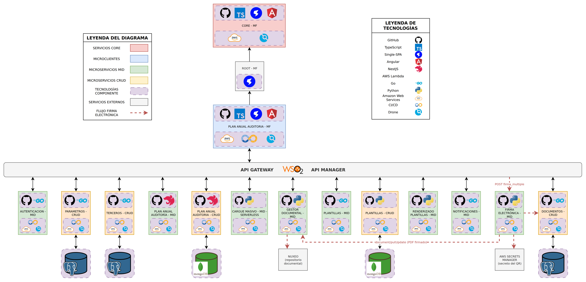
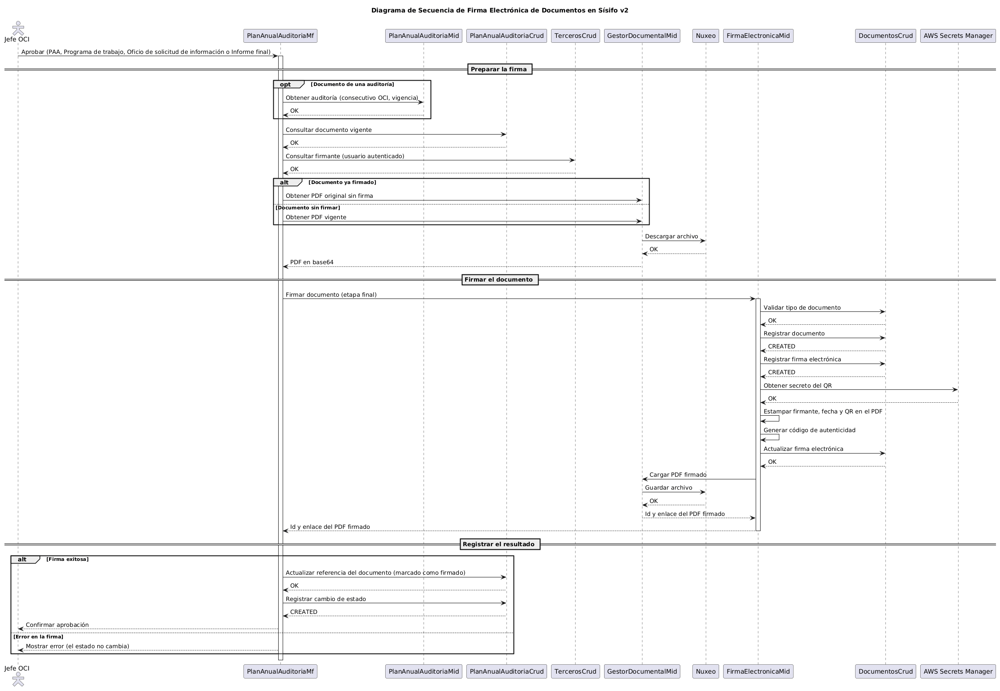

# Arquitectura e integración de firma electrónica — Sísifo v2

Este documento describe cómo se integra el servicio de firma electrónica (`firma_electronica_mid`) con los demás componentes de Sísifo v2: los documentos que se firman, el flujo de datos, los servicios y endpoints que intervienen y la configuración.

## 1. Diagrama de arquitectura

Fuente editable: [diagrama_arquitectura.drawio](diagrama_arquitectura.drawio). El PNG también trae el diagrama embebido y se puede abrir en draw.io.

El diagrama parte del diagrama de arquitectura de Sísifo v2 ([#652](https://github.com/udistrital/sisifo_documentacion/issues/652)) y agrega:

- **FIRMA ELECTRÓNICA - MID**: servicio que estampa la firma y el QR en el PDF y registra la firma.
- **DOCUMENTOS - CRUD**: almacena el registro del documento y de la firma electrónica.
- **Nuxeo**: repositorio documental que guarda los PDF. Se accede a través de GESTOR DOCUMENTAL - MID.
- **AWS Secrets Manager**: guarda el secreto con el que se firma el QR del documento.

Las flechas rojas punteadas marcan el flujo de la firma electrónica.

## 2. Documentos que se firman

Firma siempre el **Jefe de la Oficina de Control Interno** autenticado. La firma se aplica **antes** del cambio de estado: si falla, el registro no cambia de estado.

| Documento | Fase › pantalla | Momento de la firma |
|---|---|---|
| Formato PAA Original | Programación › revisión del Jefe OCI | Al aprobar el PAA y enviarlo al comité |
| Programa de trabajo | Planeación › auditorías internas › revisión de documentos | Al aprobar el programa de trabajo |
| Oficio de solicitud de información | Planeación › auditorías internas y seguimiento/informes de ley › revisión de documentos | Con el botón de firma del oficio, o al aprobar y enviar al auditado si aún no está firmado |
| Informe final | Ejecución › auditorías internas y seguimiento/informes de ley › revisión de documentos | Al aprobar el informe final |

Si un documento ya estaba firmado y se vuelve a firmar, se firma el **PDF original sin firma** (`metadatos.nuxeo_enlace_sin_firma`). Así el documento no acumula firmas.

## 3. Flujo de la firma

Fuente: [secuencia_firma_electronica.puml](secuencia_firma_electronica.puml) (PlantUML).

1. **Preparar la firma** (`plan_anual_auditoria_mf`):
   - Si el documento es de una auditoría, consulta la auditoría para armar el nombre y los metadatos del PDF (consecutivo OCI, vigencia).
   - Consulta el registro del documento vigente y los datos del firmante (nombre, tipo y número de identificación).
   - Descarga el PDF desde Nuxeo en base64. Si el documento ya estaba firmado, descarga el original sin firma.
2. **Firmar** (`firma_electronica_mid`, etapa final `etapa_firma: 3`):
   - Valida el tipo de documento y registra el documento y la firma en `documentos_crud`.
   - Genera el QR firmado con el secreto de AWS Secrets Manager y estampa en el PDF el firmante, la fecha y el QR.
   - Calcula el código de autenticidad y actualiza la firma en `documentos_crud`.
   - Carga el PDF firmado en Nuxeo a través de `gestor_documental_mid` y devuelve su `Id` y `Enlace`.
3. **Registrar el resultado** (`plan_anual_auditoria_mf`):
   - Actualiza el **mismo** registro `documento` en `plan_anual_auditoria_crud` con el enlace del PDF firmado, `metadatos.firmado = true` y `metadatos.nuxeo_enlace_sin_firma`. Así todas las vistas muestran el documento firmado.
   - Registra el cambio de estado del plan o de la auditoría.

## 4. Servicios involucrados

| Componente | Tipo | Tecnología | Papel en la firma | Repositorio |
|---|---|---|---|---|
| PLAN ANUAL AUDITORIA - MF | Microcliente | Angular + Single-SPA | Orquesta el flujo: obtiene el PDF y el firmante, llama a la firma, actualiza el documento y cambia el estado | [plan_anual_auditoria_mf](https://github.com/udistrital/plan_anual_auditoria_mf) |
| FIRMA ELECTRÓNICA - MID | MID | Python (Flask) | Estampa la firma y el QR, registra la firma y carga el PDF firmado | [firma_electronica_mid](https://github.com/udistrital/firma_electronica_mid) |
| DOCUMENTOS - CRUD | CRUD | Go (Beego) + PostgreSQL | Tipos de documento, documento y firma electrónica (código de autenticidad, firmantes) | [documentos_crud](https://github.com/udistrital/documentos_crud) |
| GESTOR DOCUMENTAL - MID | MID | Python | Fachada de Nuxeo: descarga el PDF original y carga el PDF firmado | [gestor_documental_mid](https://github.com/udistrital/gestor_documental_mid) |
| Nuxeo | Servicio externo | — | Repositorio de los PDF | — |
| AWS Secrets Manager | Servicio externo | AWS | Secreto con el que se firma y valida el QR | — |
| PLAN ANUAL AUDITORÍA - MID | MID | NestJS | Datos de la auditoría para el nombre y los metadatos del PDF | [plan_anual_auditoria_mid](https://github.com/udistrital/plan_anual_auditoria_mid) |
| PLAN ANUAL AUDITORIA - CRUD | CRUD | NestJS + MongoDB | Registro `documento` (referencia al PDF) y cambios de estado | [plan_anual_auditoria_crud](https://github.com/udistrital/plan_anual_auditoria_crud) |
| TERCEROS - CRUD | CRUD | Go | Datos del firmante | [terceros_crud](https://github.com/udistrital/terceros_crud) |

## 5. Endpoints del flujo

Todos los servicios se consumen desde el MF a través del API Gateway (WSO2 API Manager). Rutas sin host ni payload.

### Desde `plan_anual_auditoria_mf`

| Servicio | Método | Ruta | Uso |
|---|---|---|---|
| PlanAnualAuditoriaMid | GET | `auditoria/{auditoriaId}` | Consecutivo OCI y vigencia de la auditoría |
| PlanAnualAuditoriaCrud | GET | `documento?query=referencia_id:{id},tipo_id:{tipo},activo:true` | Documento vigente a firmar |
| TercerosCrud | GET | `tercero/identificacion?documento={documento}` | Firmante (usuario autenticado) |
| GestorDocumentalMid | GET | `document/{uuid}` | PDF en base64 (vigente u original sin firma) |
| **FirmaElectronicaMid** | **POST** | **`v1/firma_multiple`** | Firma el PDF (`etapa_firma: 3`) y devuelve `Id` y `Enlace` del PDF firmado |
| PlanAnualAuditoriaCrud | PUT | `documento/{documentoId}` | Referencia al PDF firmado, `firmado` y `nuxeo_enlace_sin_firma` |
| PlanAnualAuditoriaCrud | POST | `estado` (PAA) · `auditoria-estado` (auditoría) | Cambio de estado tras la firma |

### Desde `firma_electronica_mid`

| Servicio | Método | Ruta | Uso |
|---|---|---|---|
| DocumentosCrud | GET | `tipo_documento/{id}` | Valida el tipo de documento |
| DocumentosCrud | POST | `documento` | Registra el documento |
| DocumentosCrud | POST | `firma_electronica` | Registra la firma |
| AWS Secrets Manager | — | Secreto `QR_SECRET_NAME` (versión `AWSCURRENT`) | Firma el token del QR |
| DocumentosCrud | PUT | `firma_electronica/{id}` | Guarda el código de autenticidad, la firma encriptada y los firmantes |
| GestorDocumentalMid | PUT | `document/putUpdate` | Carga el PDF firmado en Nuxeo |

### Petición a `v1/firma_multiple`

Se envía un arreglo con un documento por elemento:

| Campo | Descripción |
|---|---|
| `IdTipoDocumento` | Tipo de documento en `documentos_crud` |
| `nombre`, `descripcion` | Nombre y descripción del PDF firmado |
| `etapa_firma` | `3` (etapa final: firma criptográfica + QR). Debe ser **numérico**: con `"3"` sólo se estampa el sello, sin firma |
| `firmantes` | Firmantes que se estampan en el PDF: `nombre`, `cargo`, `oficina`, `tipoId`, `identificacion` |
| `representantes` | Vacío en Sísifo |
| `metadatos` | Metadatos del documento. En la etapa final deben incluir también `firmantes` y `representantes` |
| `file` | PDF original en base64 |

Respuesta: `{ Status, res: { Id, Enlace, ... } }`, la respuesta del gestor documental con el PDF firmado.

## 6. Configuración

| Componente | Variable | Descripción |
|---|---|---|
| `plan_anual_auditoria_mf` | `FIRMA_SERVICE` (en `src/environments/*`) | URL base de `firma_electronica_mid/v1/` en el API Gateway |
| `firma_electronica_mid` | `DOCUMENTOS_CRUD_URL` | URL de `documentos_crud` |
| `firma_electronica_mid` | `GESTOR_DOCUMENTAL_URL` | URL de `gestor_documental_mid` |
| `firma_electronica_mid` | `VERIFICACION_EXTERNA` | URL de verificación externa: destino del QR |
| `firma_electronica_mid` | `QR_SECRET_PROVIDER`, `QR_SECRET_NAME` | `prod` usa AWS Secrets Manager; `dev` usa un mapa local de secretos |

Los valores de cada ambiente se gestionan en la configuración de despliegue de cada repositorio. No se documentan aquí.
